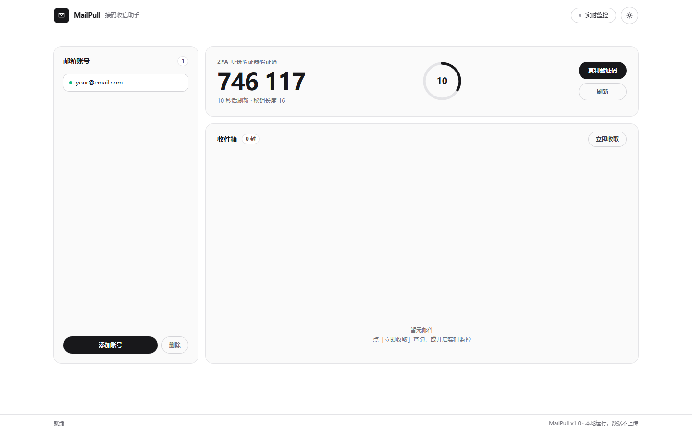
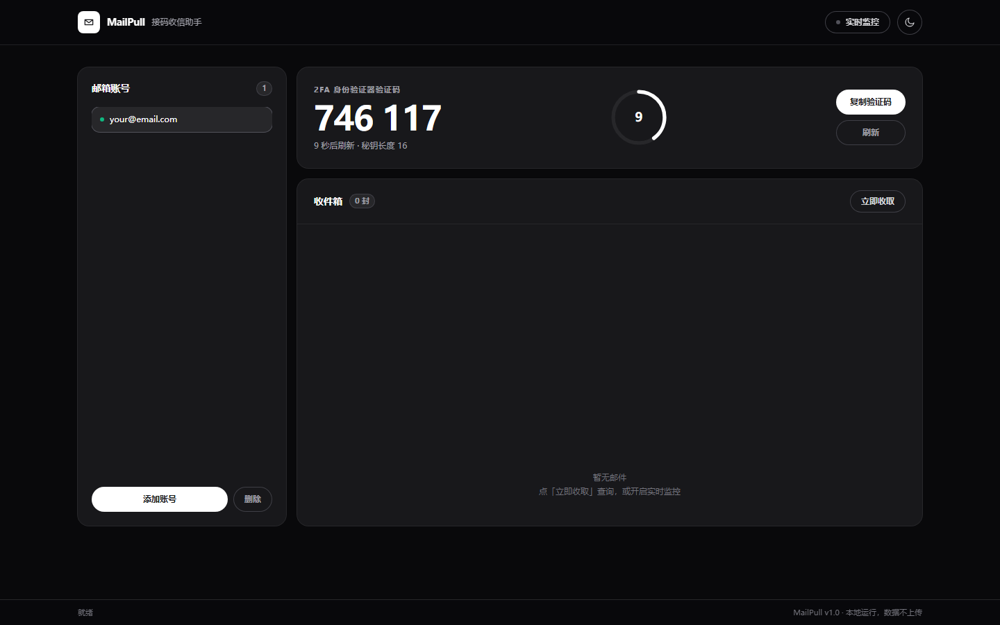

# MailPull

**接码邮箱收信助手** —— 把散落在多个邮箱里的验证码收进一个界面，顺带生成 2FA 动态码。



<details>
<summary>暗色主题</summary>



</details>

---

## 仓库里有什么

| 目录 | 是什么 | 技术栈 |
|---|---|---|
| 根目录 | **MailPull** 命令行版，收信 + 2FA | Python 标准库，零第三方依赖 |
| `mailpull_web/` | **MailPull** 图形版，浏览器界面 | Python 标准库 + 原生 JS |
| `marketing-sections/` | 三个可复用营销区块组件 | Next.js 14 + Tailwind CSS |

两个 MailPull 版本共用同一份账号文件（`~/.mailpull/accounts.json`），一边加的号另一边直接能读到。

## 五分钟跑起来

**命令行版**

```bash
python mailpull.py add 你的邮箱 你的密码 你的2FA秘钥
python mailpull.py get       # 收一次邮件
python mailpull.py watch     # 实时盯着，来信立刻显示验证码
```

**图形版**

```bash
python mailpull_web/server.py
```

浏览器会自动打开。界面资源已内联，断网也能打开，只有收信时才联网。

**营销区块**

```bash
cd marketing-sections
npm install
npm run dev
```

## 特色

- **2FA 一体** —— 收信和 TOTP 动态码在同一个界面，不用来回切验证器 App
- **零依赖** —— Python 只用标准库；前端除 Tailwind 编译产物外不引任何框架
- **验证码智能提取** —— 中英文、简繁体、纯数字、字母数字混合都能识别，自动剔除日期/网址/电话等噪声避免误判
- **可打包单文件 exe** —— 目标机器不装 Python 也能跑（见各子目录 README）
- **明暗双主题** —— 营销区块和图形版都支持，跟随系统偏好

## 已知限制

- 只负责**收信**和**生成 2FA 码**，不包含自动注册类功能
- 部分平台的收信接口不是标准形式，需要在账号里手动填一次接口地址
- 上游有频率限制时会返回 429，已内置指数退避重试（1.2s → 2.4s → 4.8s）

## License

[MIT](LICENSE)

---

# MailPull 详细文档

一个命令搞定：**接码邮箱收验证码 + 2FA 动态码生成**，多账号批量管理。

零第三方依赖，只用 Python 标准库。Windows / macOS / Linux 全平台通用。

---

## 一、5 秒上手

```bash
python mailpull.py add 你的邮箱 你的密码 你的2FA秘钥
python mailpull.py get          # 收一次邮件
python mailpull.py totp         # 出 2FA 动态码
```

添加账号时工具会自动完成三件事：
1. **探测收信接口地址**（`https://mail.<域名>/api/fetch`），不用手填
2. **校验 2FA 秘钥是否有效**（当场生成一个码给你看）
3. **保存到本地**（`~/.mailpull/accounts.json`，权限 600 仅本人可读）

---

## 二、命令一览

| 命令 | 作用 |
|---|---|
| `add 邮箱 密码 [秘钥]` | 添加账号（不带秘钥也能加，只是没 2FA） |
| `list` | 查看所有账号 + 各账号当前 2FA 码 |
| `get [邮箱]` | 收一次邮件，打印验证码 |
| `watch [邮箱]` | **实时监控**，新邮件立刻弹出，只报新的不刷屏 |
| `totp [邮箱]` | 生成当前 2FA 动态验证码 |
| `export codes` | 批量拉取所有账号的最新验证码 |
| `del 邮箱` | 删除账号 |
| `repl` | 交互模式，一直挂着随时敲命令 |

### 常用参数

```bash
python mailpull.py add 邮箱 密码 秘钥 --api https://xxx.com/api/fetch
    # --api 手动指定收信接口。自动探测失败时用它

python mailpull.py watch -i 3        # 3 秒轮询一次（默认 5 秒）
python mailpull.py watch -v           # 显示错误详情

python mailpull.py export codes -o 结果.csv    # 导出成 CSV 表格
python mailpull.py export codes -o 结果.json   # 导出成 JSON
python mailpull.py export codes --delay 2      # 多账号间隔 2 秒，防限流
```

---

## 三、账号信息格式

工具统一认这一种格式，跟主流接码平台导出的格式一致：

```
邮箱地址----密码----2FA秘钥
```

添加时可以只贴一整行，工具自己拆：

```bash
python mailpull.py add user@example.com passwd ABCDEFGHIJKLMNOP
```

2FA 秘钥就是 Google 身份验证器里那种 Base32 字符串（如 `JBSWY3DPEHPK3PXP`）。
**工具生成的码和你手机上 Google 验证器显示的完全一致**（已通过 RFC 6238 官方测试向量校验）。

---

## 四、收信原理与兼容性说明

工具对接的是接码邮箱平台的**公开收信接口**，不是 IMAP。

```
GET https://mail.<你的域名>/api/fetch?email=<邮箱地址>
```

返回 JSON，工具会自动识别这些字段名：
- 邮件数组：`emails` / `mails` / `messages` / `data` / `items` / `list` / `results`
- 主题：`subject` / `title` / `sub`
- 正文：`body` / `body_preview` / `text` / `content` / `html` / `preview`
- 验证码：`code` / `codes`（服务端给了就直接用，没给就从正文里智能提取）

**验证码提取**支持中英文、简繁体、数字码和字母数字混合码（如 `A1B2C3`），
会自动剔除网址、日期、电话号码等噪声，避免把无关数字误当成验证码。

**接口限流**：遇到 429 / 5xx 自动指数退避重试（1.5s → 3s → 6s），不会因为请求太快而丢数据。

---

## 五、打包成 exe 发给客户

方式一：**双击 `build.bat`**，自动装依赖并打包，产出 `dist\MailPull.exe`。

方式二：手动执行

```bash
pip install pyinstaller
pyinstaller -F --clean --name MailPull --icon=logo.ico --version-file=version_info.txt mailpull.py
```

生成的 `dist/MailPull.exe` 双击即用，客户电脑不用装 Python。

> 用 `-F`（单文件）但**不加 `-w`**，保留控制台窗口——这是命令行工具，
> 客户双击后需要看到输出、能输入命令。`-w` 会让窗口一闪而过，客户反而没法用。

准备自定义图标：把 `.ico` 文件放进目录，改一下命令里的 `--icon=xxx.ico` 即可
（`logo.ico` 由 `make_icon.py` 生成，也可直接替换成你自己的）。

改完 `version_info.txt` 里的版本号，exe 属性面板里的信息会同步更新。

---

## 六、常见问题

**Q：添加时提示「接口探测失败」？**
A：说明这个平台的收信接口不是标准形式。手动指定：
```bash
python mailpull.py add 邮箱 密码 秘钥 --api "https://你的域名/实际接口路径"
```
先用浏览器打开面板，查看「查询邮件」时浏览器 Network 里那个 fetch 请求地址，填进去即可。

**Q：2FA 秘钥提示无效？**
A：检查是否复制完整（Base32 长串，中间常被截断），以及是不是少了 `=` 补位符。

**Q：收不到邮件？**
A：邮箱必须先有人往里发信才会出现内容。用 `watch` 挂着，然后去触发发信（注册/登录某个平台），验证码邮件一到就会实时弹出来。

**Q：账号存在哪？会不会泄露？**
A：`~/.mailpull/accounts.json`，文件权限设为 600（仅当前用户可读）。不想留就 `del` 掉，或直接删这个文件。

**Q：Windows 打开是黑框一闪而过？**
A：打包时不要加 `-w` 参数（保留控制台）。这个工具是命令行程序，
需要看到输出。直接双击 exe 会进交互模式常驻，输 `q` 退出。

**Q：中文显示成乱码？**
A：新版已在 `main()` 前强制 `stdout/stderr` 为 UTF-8 并设置
`PYTHONIOENCODING=utf-8`。若仍是旧版本，重新打包即可。

---

## 七、免责声明

本工具仅供用户在**已获授权**的邮箱账号上收取自己的邮件使用。
使用者需自行确保使用场景合规，不得用于批量注册、账号爆破、垃圾邮件等用途。